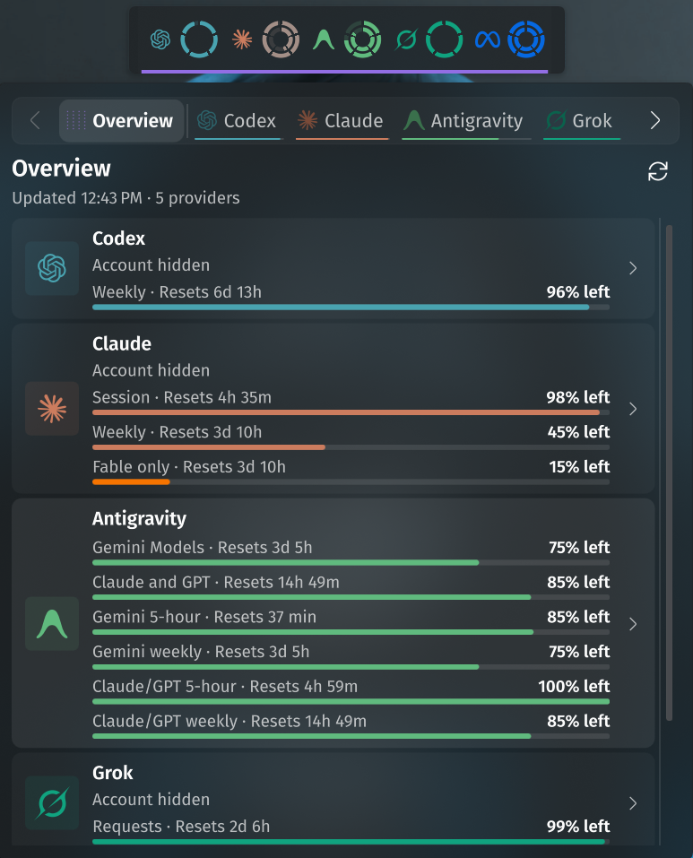
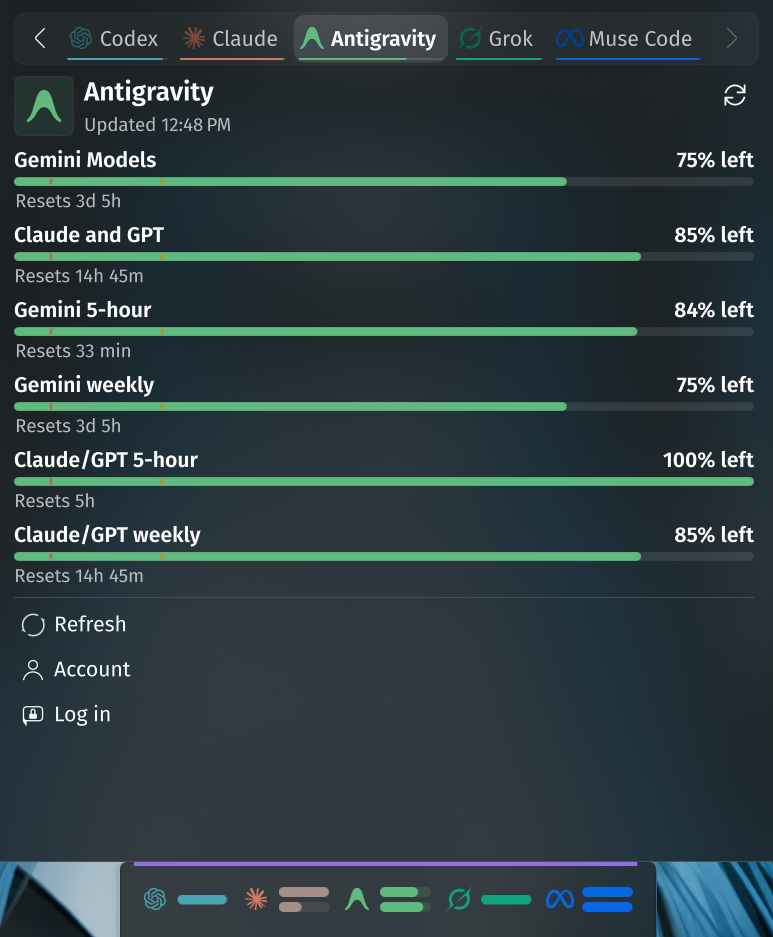
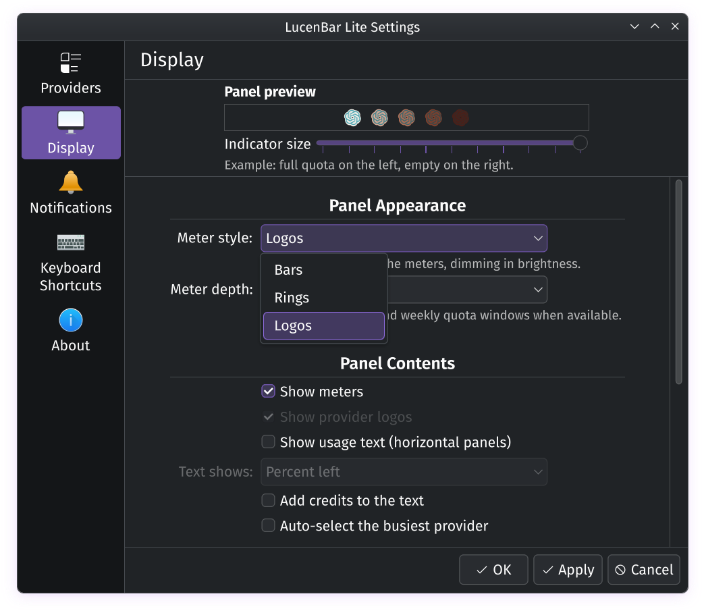

# LucenBar Lite

A KDE Plasma 6 panel widget that shows your AI provider quotas at a glance.
It reads usage from the [CodexBar CLI](https://github.com/steipete/CodexBar)
and covers Codex, Claude, Gemini/Antigravity, Grok, and the other providers
the CLI supports.

LucenBar Lite is a trimmed fork of
[CodexBar Plasma](https://github.com/Lucenx9/codexbar-plasma) by
**Lucenx9**. Most of the code, the design, and the translations are Lucenx9's
work. If you want the full-featured widget (cost history, sessions,
diagnostics, multiple accounts, AI insights), use the original.

| Overview with ring meters | Provider tab with bar meters | Display settings |
| --- | --- | --- |
|  |  |  |

## What it does

- **Panel:** quota at a glance as stacked bars, concentric rings, or provider
  logos that dim as quota runs out. Drag meters to reorder providers.
- **Popup:** an Overview tab plus one tab per provider, with every quota window,
  reset times, pace forecasts, and credits. Click a provider logo to show or
  hide it in the panel. Refresh, Account, and Log in / API Key buttons per
  provider.
- **Notifications:** warning and critical thresholds, optional meter coloring,
  and desktop notifications when a quota crosses a threshold, will run out
  before it resets, or resets.

## Requirements

- KDE Plasma 6
- `python3` (login, Radius usage, and CLI-manager helpers)
- The CodexBar CLI. If `codexbar` is not on your `PATH`, open the widget
  settings and click **Update now** on the Providers page. This downloads an
  official Linux build to `~/.local/share/lucenbar/cli/` and selects it.
- `notify-send` (libnotify) for desktop notifications

## Install

From the KDE Store: **Add Widgets → Get New Widgets → Download New Plasma
Widgets**, search for **LucenBar Lite**.

From a package file, download `lucenbar-lite-<version>.plasmoid` from
[Releases](https://github.com/JangMan-J/lucenbar/releases) and run:

```sh
kpackagetool6 -t Plasma/Applet -i lucenbar-lite-1.0.0.plasmoid
```

Upgrade with `-u` instead of `-i`. Then add **LucenBar Lite** to a panel.

LucenBar Lite has its own plugin ID (`io.github.jangmanj.lucenbarlite`), so it
can be installed next to CodexBar Plasma. Its data lives in
`~/.local/share/lucenbar/`, separate from CodexBar Plasma.

## Build from source

```sh
./package.sh
```

This writes `dist/lucenbar-lite-<version>.plasmoid`. Development notes are in
[HANDOFF.md](HANDOFF.md).

## License and credits

MIT. See [LICENSE](LICENSE) and [NOTICE.md](NOTICE.md).

- Original widget: [CodexBar Plasma](https://github.com/Lucenx9/codexbar-plasma)
  by Lucenx9. If you find this widget useful, consider
  [supporting Lucenx9 on Ko-fi](https://ko-fi.com/lucenx9).
- CodexBar CLI and most provider icons:
  [CodexBar](https://github.com/steipete/CodexBar) by Peter Steinberger.
- Poe icon: SVG Stack, CC BY 4.0.
- LucenBar icon: generated with Recraft AI; the original with its C2PA
  provenance manifest is `docs/icon-source-12-segmented-reserve.svg`.

This fork is not maintained or endorsed by Lucenx9 or the CodexBar authors.
Please report problems with LucenBar Lite at
<https://github.com/JangMan-J/lucenbar/issues>, not upstream.
